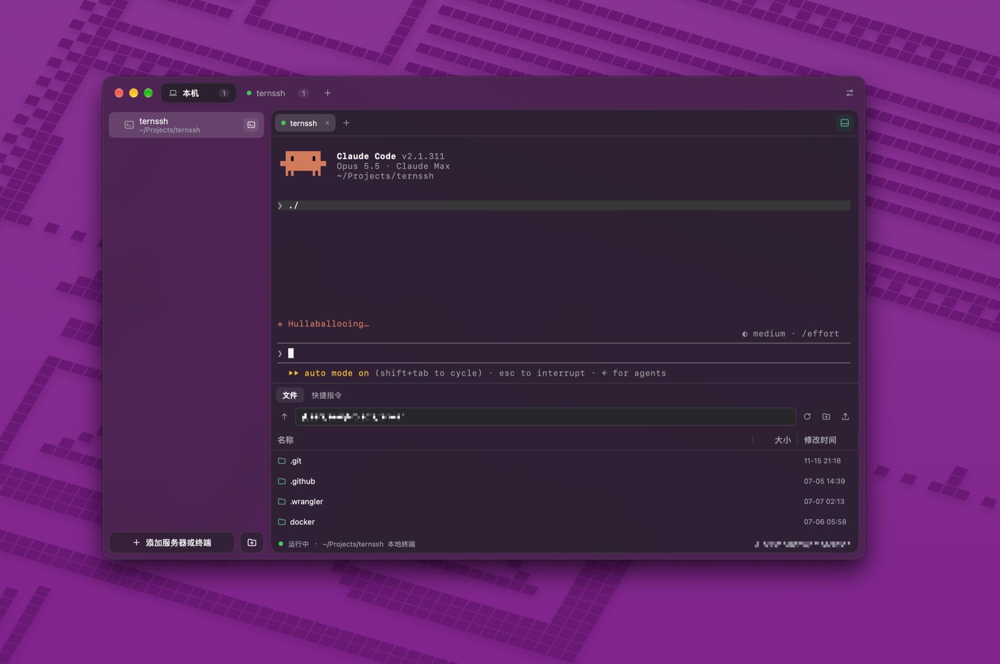
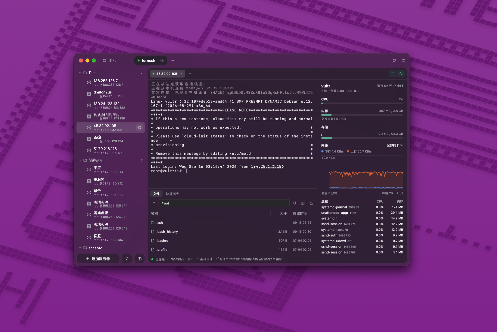

# ternssh desktop

English | [简体中文](README.md)

The desktop client of [ternssh](https://github.com/haradakashiwa/ternssh): a native SSH terminal and server manager for macOS and Windows. Its interface is written in [MyGo](https://github.com/egoist/mygo)'s native UI, with no WebView.

- **Works on its own**: without adding any site, the "Local" tab manages servers and local terminals, with credentials kept in the system keychain.
- **Synced across devices**: once a ternssh site is added, its servers, groups and snippets appear in a tab of their own, and changes made in the client are written back to the site.
- **Every connection is made from this machine**: a site only syncs the SSH details, and no traffic goes through it.





## Download

Download from [Releases](https://github.com/haradakashiwa/ternssh-desktop/releases):

| System | File |
|---|---|
| macOS (Apple silicon and Intel) | `ternssh-<version>-macos-universal.dmg` |
| Windows x64 | `…-windows-amd64-setup.exe` (installer) or `…-windows-amd64-portable.zip` (portable) |
| Windows ARM64 | `…-windows-arm64-setup.exe` or `…-windows-arm64-portable.zip` |

The builds are not signed with a developer certificate: on macOS, right-click the app and choose "Open" the first time; on Windows, if SmartScreen warns, click "More info" → "Run anyway".

## Features

- **Servers**: servers and groups on this machine or on a ternssh site, arranged by drag and drop, with changes synced both ways.
- **Terminals**: tabs of SSH and local terminals, built on libghostty-vt.
- **Files**: browse files over SFTP and on this machine, upload and download, and double-click to edit in an editor with syntax highlighting.
- **Snippets**: run common commands in the terminal in one click; a site's snippets are shared with its web app.
- **Server status**: live CPU, memory, disk, network and process monitoring (Linux).
- **Tray and global hotkey**: closing the window keeps the app in the tray, and a hotkey brings it back.
- **Languages**: Simplified Chinese and English, following the system by default, switchable in the settings.

## Development

Requires Go 1.27.3+ (`GOTOOLCHAIN=auto` downloads it).

```sh
make dev                                # run with live reload
make mac                                # build the macOS .app and .dmg
make windows                            # cross-compile Windows x64/ARM64 and installers (needs NSIS)
make test                               # vet (Windows too) and tests
SNAPSHOT_DIR=/tmp/snap go test ./gui    # write snapshots of the UI
```

## Releasing

Push a tag starting with `v`, and GitHub Actions (`.github/workflows/release.yml`) tests, builds and creates the release. The version comes from the tag, so `mygo.json` needs no change; a version with `-` (such as `v0.2.0-beta.1`) is marked as a pre-release.

```sh
git tag v0.2.0 && git push origin v0.2.0
```

## Layout

| Path | Contents |
|---|---|
| `main.go` | The platform parts: window, tray, global hotkey, system keychain, file pickers |
| `gui/` | Native UI and state: site tabs, sidebar, terminals, panels, editor, dialogs |
| `internal/ternssh` | HTTP API client of ternssh sites |
| `internal/sshconn` | SSH connections, SFTP and local files |
| `locales/` | UI text: `en.json` (the source language) and `zh-Hans.json`; `catalog_gen.go` is generated by `mygo dev`/`mygo build`/`mygo generate` |
| `internal/store` | Sites, local servers, snippets and settings (`config.json`), with secrets in the system keychain |
