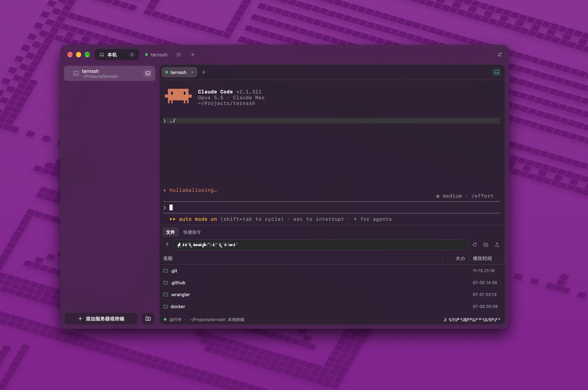
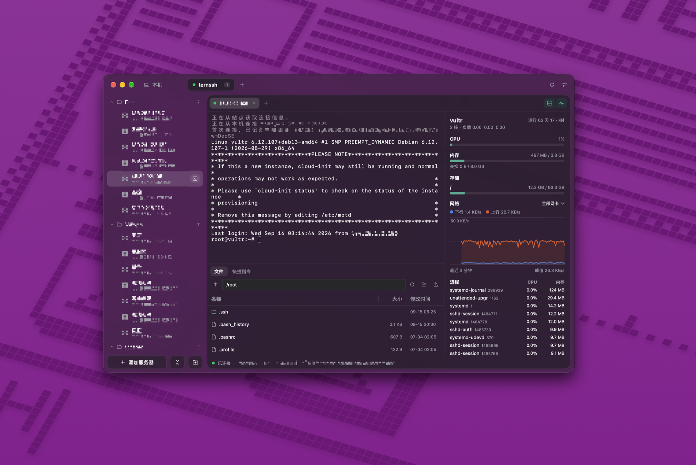

# ternssh desktop

English | [简体中文](README.zh.md)

The desktop client of [ternssh](https://github.com/haradakashiwa/ternssh): a native SSH terminal and server manager for macOS and Windows. Its interface is written in [MyGo](https://github.com/egoist/mygo)'s native UI, with no WebView.

- **Works on its own**: without adding any site, the "Local" tab manages servers and local terminals, with credentials kept in the system keychain.
- **Synced across devices**: once a ternssh site is added, its servers, groups and snippets appear in a tab of their own, and changes made in the client are written back to the site.
- **Every connection is made from this machine**: a site only syncs the SSH details, and no traffic goes through it.

## Download

Download from [Releases](https://github.com/haradakashiwa/ternssh-desktop/releases):

| System | File |
|---|---|
| macOS (Apple silicon and Intel) | `ternssh-<version>-macos-universal.dmg` |
| Windows x64 | `…-windows-amd64-setup.exe` (installer) or `…-windows-amd64-portable.zip` (portable) |
| Windows ARM64 | `…-windows-arm64-setup.exe` or `…-windows-arm64-portable.zip` |

The builds are not signed with a developer certificate: on macOS, right-click the app and choose "Open" the first time; on Windows, if SmartScreen warns, click "More info" → "Run anyway".

## Features

- **Servers**: servers and groups on this machine or on a ternssh site, arranged by drag and drop, with changes synced both ways.
- **Terminals**: tabs of SSH and local terminals, built on libghostty-vt.
- **Files**: browse files over SFTP and on this machine, upload and download, and double-click to edit in an editor with syntax highlighting.
- **Snippets**: run common commands in the terminal in one click; a site's snippets are shared with its web app.
- **Server status**: live CPU, memory, disk, network and process monitoring (Linux).
- **Web**: turned on in the settings, the app serves itself to a browser while it runs: the same tabs, servers, snippets and terminals, in step with the window both ways. The settings choose the port and who gets in: this machine only, the local network, or the public network; beyond this machine, browsers sign in with a username and password (HTTP basic authentication), and an address that keeps getting it wrong is locked out for longer each time. Put it behind HTTPS when it faces the internet.
- **Tray and global hotkey**: closing the window keeps the app in the tray, and a hotkey brings it back.
- **Languages**: Simplified Chinese and English, following the system by default, switchable in the settings.
- **Updates**: checks this repository's releases once a day, or from the settings and the tray, and installs a new version in the app, then relaunches.
