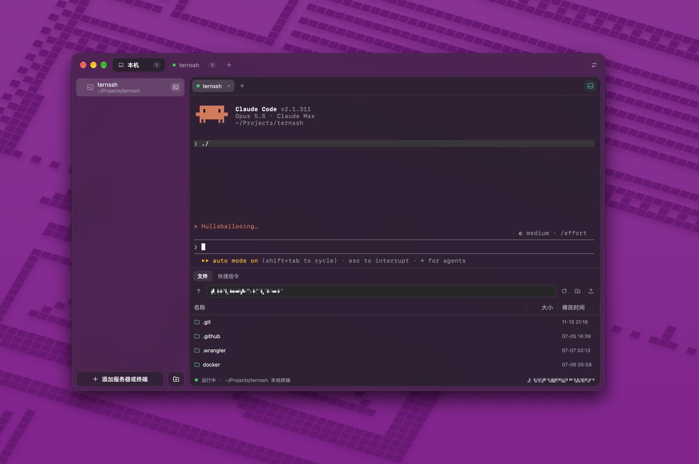
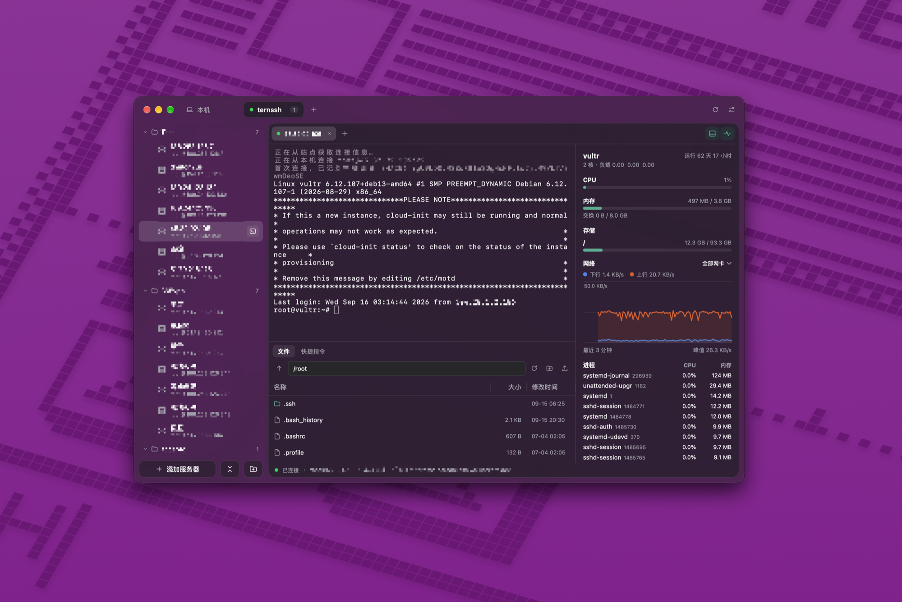

# ternssh desktop

[English](README.md) | 简体中文

[ternssh](https://github.com/haradakashiwa/ternssh) 的桌面客户端：一个原生的 SSH 终端与服务器管理工具，支持 macOS 和 Windows。界面用 [MyGo](https://github.com/egoist/mygo) 原生 UI 编写，没有 WebView。

- **本机即可使用**：不添加任何站点，也能在「本机」标签里管理服务器和本地终端，凭据存在系统钥匙串。
- **多设备同步**：添加 ternssh 站点后，站点上的服务器、分组和快捷指令出现在独立的标签里，在客户端的修改会写回站点。
- **所有连接都从本机发起**：站点只用来同步 SSH 信息，不经它转发流量。

## 下载

在 [Releases](https://github.com/haradakashiwa/ternssh-desktop/releases) 下载：

| 系统 | 文件 |
|---|---|
| macOS（Apple 芯片与 Intel） | `ternssh-<版本>-macos-universal.dmg` |
| Windows x64 | `…-windows-amd64-setup.exe`（安装包）或 `…-windows-amd64-portable.zip`（免安装） |
| Windows ARM64 | `…-windows-arm64-setup.exe` 或 `…-windows-arm64-portable.zip` |

安装包没有开发者证书签名：macOS 首次打开时请右键应用选「打开」；Windows 若出现 SmartScreen 提示，点「更多信息」→「仍要运行」。

## 功能

- **服务器管理**：本机或 ternssh 站点的服务器与分组，拖拽整理，站点上的修改双向同步。
- **终端**：多标签 SSH 终端和本地终端，基于 libghostty-vt。
- **文件**：SFTP 和本机文件浏览、上传下载，双击即可在带语法高亮的编辑器中修改。
- **快捷指令**：一键在终端运行常用命令，站点的指令与网页端共享。
- **服务器状态**：CPU、内存、磁盘、网络流量和进程的实时监控（Linux）。
- **网页**：在设置中开启后，应用运行时可在浏览器中使用：同样的标签、服务器、快捷指令和终端，与窗口双向实时同步。可自定义端口和访问范围：仅本机、局域网或公网；本机以外的访问须用用户名和密码登录（HTTP Basic Auth），同一地址连续输错会被锁定且时间逐轮加倍。暴露到公网时建议放在 HTTPS 之后。
- **托盘与全局快捷键**：关闭窗口后驻留托盘，随时一键唤出。
- **多语言**：简体中文和英文，默认跟随系统，可在设置中切换。
- **自动更新**：每天检查本仓库的 Releases，也可在设置或托盘中手动检查，在应用内下载安装新版本后重启。
